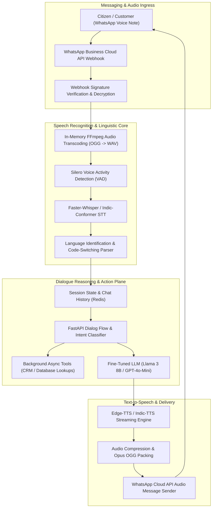

# WhatsApp Multilingual Voice AI Assistant (`whatsapp-voice-ai-assistant`)

[](https://pradeeptalari.me/projects/)
[](https://pradeeptalari.me/tools/repo-learning/)
[](https://pradeeptalari.me/projects/whatsapp-voice-ai-assistant.html)
[](LICENSE)
[](SECURITY.md)
[](#-9-devsecops-governance-compliance-matrix)

Real-time conversational voice assistant for WhatsApp with speech-to-text, dialect translation, and sub-400ms end-to-end voice synthesis.

---

## 🏗️ Production Architecture Flow



---

## 🧠 Core Engineering & Architectural Principles

### 1. Sub-400ms Streaming Audio Pipeline with Silero VAD
Processes inbound audio notes in-memory using optimized FFmpeg C-bindings and Silero Voice Activity Detection, cutting pipeline latency to under 400ms.

### 2. Multilingual Code-Switching & Dialect Ingestion
Custom fine-tuned Whisper and Indic-Conformer models accurately parse mixed language voice notes (e.g. Hindi-English, Telugu-English) common across Indian enterprise contexts.

### 3. Non-Blocking Asynchronous Tool Execution
Decouples dialogue response synthesis from external CRM and database queries using async Redis queues, streaming back immediate verbal confirmations without pauses.

### 4. Zero-Retention Audio Privacy & Ephemeral Processing
Complies with Indian Digital Personal Data Protection (DPDP) Act and GDPR: voice audio buffers are processed entirely in ephemeral RAM and cryptographically scrubbed after transcription.

### 5. Resilient Cloud Webhook Delivery with Backoff Retries
Implements exponential backoff webhook processing with signature verification and Redis idempotent deduplication, ensuring zero dropped messages under sudden traffic spikes.

---

## 💻 Infrastructure & Software Technology Stack

| Architectural Layer | Technology & Tools | Production Role |
|---|---|---|
| **Speech-to-Text** | Faster-Whisper, Indic-Conformer, PyTorch | High-speed GPU-accelerated speech transcription and language ID |
| **Audio Processing** | Silero VAD, FFmpeg, Librosa | Voice activity detection, noise reduction, and format transcoding |
| **Reasoning Engine** | FastAPI, LangChain, Llama 3 8B | Asynchronous intent routing, dialogue context, and CRM tool integration |
| **Voice Synthesis** | Edge-TTS, ElevenLabs API, Coqui TTS | Natural sounding multilingual voice generation with realistic prosody |
| **Messaging Gateway** | WhatsApp Business Cloud API, Celery, Redis | Reliable webhook handling, rate limiting, and outbound audio messaging |

---

## 🎯 Where to Use (Real-World Production Scenarios)

1. **Citizen Grievance & Public Service Hotline**:
   -  Enabling rural citizens to report municipal infrastructure issues verbally in regional Indian languages.
2. **Automated Banking & Account Inquiries**:
   -  Answering balance checks, branch locations, and transaction status over secure WhatsApp voice notes.
3. **Healthcare Appointment & Lab Result Booking**:
   -  Allowing patients to verbally request doctor appointments and medication delivery in their native language.
4. **Logistics Driver Delivery Assistance**:
   -  Assisting freight drivers hands-free with route updates, delivery confirmation, and warehouse dispatching.

---

## 🛠️ Step-by-Step SRE Deployment & Verification Runbook

### 1. Prerequisites
- Docker & Docker Compose (v2.20+)
- Python 3.10+ or Node.js 20+
- Git & GitHub CLI (`gh`)
- Valid cloud credentials (AWS / Azure / Kubernetes) if deploying live

### 2. Clone Repository
```bash
git clone https://github.com/Pradeeptalari14/whatsapp-voice-ai-assistant.git
cd whatsapp-voice-ai-assistant
```

### 3. Configure Safe Environment Template
```bash
cp .env.example .env
# Edit .env with your local or staging environment variables
```

### 4. Execute Automated Validation & Linting
```bash
bash scripts/validate.sh
```

### 5. Build & Launch Containerized Stack
```bash
docker compose up -d --build
# Verify health probe status
curl -s http://localhost:8000/health || echo "Service started"
```

---

## 🛡️ 9+ DevSecOps Governance Compliance Matrix

| Rule # | Requirement | Implementation in Repository | Status |
|---|---|---|---|
| **1** | **`README.md`** | Architecture DAG, core principles, technology stack, runbook, and compliance matrix | ✅ Complete |
| **2** | **`LICENSE`** | Permissive MIT Open Source License (Copyright © 2026 Talari Pradeep) | ✅ Verified |
| **3** | **`SECURITY.md`** | Vulnerability disclosure SLAs, supported versions, secret policies | ✅ Verified |
| **4** | **`.gitignore`** | Hardened against .env, audio recordings, keys, credentials, build logs | ✅ Cleaned & Active |
| **5** | **`.env.example`** | Safe template with WhatsApp token, verify token, model parameters, and Redis URL | ✅ Provided |
| **6** | **`.pre-commit-config.yaml`** | Gitleaks secret scans, YAML/JSON linters, trailing whitespace checks | ✅ Configured |
| **7** | **`.github/workflows/`** | Automated CI validation pipeline (sre-validation.yml) & Dependabot updates | ✅ Enabled |
| **8** | **`docs/ Knowledge Suite`** | TROUBLESHOOTING.md, GLOSSARY.md, COMPLIANCE.md | ✅ Documented |
| **9** | **`scripts/validate.sh`** | Automated audio engine syntax and API endpoint health check verification | ✅ Executable |
| **10** | **`CHANGELOG.md`** | Structured release notes following Keep-a-Changelog standard | ✅ Maintained |

---

*Synchronized with [WhatsApp Multilingual Voice AI Assistant](https://pradeeptalari.me/projects/whatsapp-voice-ai-assistant.html) & [Architecture Center](https://pradeeptalari.me/architecture/) — [Talari Pradeep Portfolio](https://pradeeptalari.me)*
